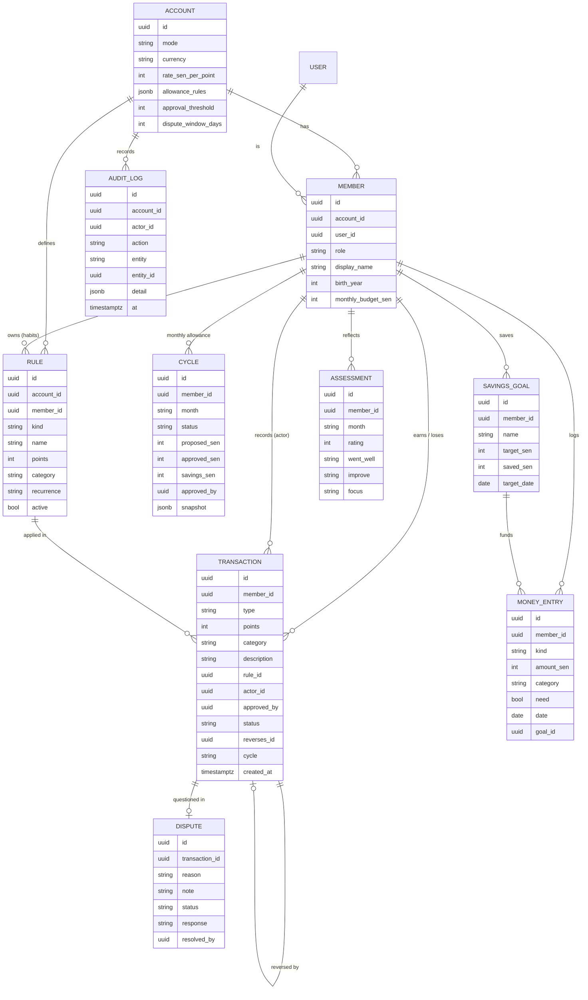
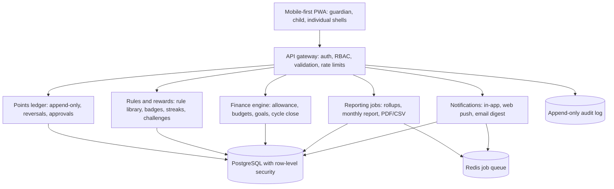

# Ritsu: product and technical plan (repo copy)

The full planning pack (vision, problem statement, personas, pain points, 14 user journeys, requirements, information architecture, UX direction, schema, architecture, points and allowance logic, business model, roadmap and acceptance criteria) lives in the shared Claude Doc **"Merit & Reward Platform: Product Plan"**. This file keeps the parts engineers need next to the code.

## 1. Product in one paragraph

Ritsu is a points-based merit and reward platform for families and individuals. Every logged action earns or costs points; points convert to a monthly allowance (Family Mode) or a guilt-free reward budget (Individual Mode) at a configurable rate, default **1 point = RM1**. Every point movement is transparent, explainable and correctable without rewriting history.

## 2. Roles and access

| Action | Guardian | Co-guardian | Child | Individual |
| --- | --- | --- | --- | --- |
| Award merit | Yes | Yes | No | Own only |
| Deduct demerit | Yes | Yes; above threshold needs approval | No | Own only |
| Approve deductions and allowance | Yes | No | No | n/a |
| Correct (reverse) an entry | Yes | Yes | No | Own only |
| Raise a dispute | No | No | Own deductions, within window | n/a |
| Change settings, rules, members | Yes | No | No | Own account |
| View | Whole family | Whole family | Self | Self |

## 3. Information architecture

| Role | Tabs |
| --- | --- |
| Guardian | Home · Award · History · Allowance · Reports · Settings |
| Co-guardian | Home · Award · History · Allowance (view) · Reports |
| Child | Home · Points · Badges · Money |
| Individual | Today · Habits · Money · Insights · Review · Settings |

Mobile: bottom tab bar. Desktop (≥1024 px): left sidebar. Global: notifications, profile switcher, toasts.

## 4. Data model (ERD)



Rules: the transactions table is append-only; balances are computed (views), never stored. Money is integer sen. Row-level security scopes every row to one account. The MVP mirrors this model in `src/lib/types.ts`.

## 5. Architecture



Start as a modular monolith (one deployable API), split later only if load requires it. Security: TLS 1.3, encryption at rest, Argon2 passwords, optional guardian 2FA, parental consent before a child profile goes live, PDPA export and deletion, no ads or trackers.

## 6. Points logic

- Merit adds a rule's points (1 to 50; custom up to 100). Demerit subtracts them. Child deductions require a reason.
- Only `posted` transactions count. A co-guardian deduction above `approvalThreshold` (default 3) is `pending` until the guardian approves.
- Corrections are reversal transactions (`reversesId`), at most the original size, one per original. A reversed demerit reduces the demerit total; it is never counted as a merit.
- Monthly points = cycle (calendar month) sum; lifetime balance = sum of all. Levels use lifetime merit only (every 60 points). Streak = consecutive days with ≥1 merit.

## 7. Allowance logic

```
V        = max(0, netPoints) × rate
B        = V × bonusPct            if merit / (merit + demerit) ≥ bonusMeritShare, else 0
A        = clamp(base + V + B, floor, cap)
savings  = A × savingsPct;  spendable = A − savings
```

Family defaults: rate RM1, base RM10, bonus 10% at 80% merit share, floor RM5, cap RM80, auto-save 20%.
Worked example: 40 merit, 5 demerit → V = 35, share 89% → B = 3.50, A = RM48.50, savings RM9.70.

Approval: blocked while any dispute for that month is open; pending deductions are shown but excluded; a changed amount needs a note; approval stores proposed and approved amounts, credits the money log and moves the savings share into the first savings goal. Closing locks the cycle.

Individual mode uses the same engine (default 1 point = RM0.50, cap RM150). Discipline score = 40% within budget + 30% savings rate vs 20% target + 30% needs share of spending.

## 8. Roadmap

1. **Phase 0, prototype (this repo, done):** all dashboards, engine, disputes, allowance, analytics, gamification, money, self-assessment; browser storage; unit tests.
2. **Phase 1, foundations (weeks 1 to 4):** backend API, PostgreSQL, auth (email for adults, family code and PIN for children), RBAC, audit log, engine server-side.
3. **Phase 2, family beta (weeks 5 to 8):** invites, onboarding wizard, push notifications, cycle reminders, Bahasa Malaysia, 30-family beta.
4. **Phase 3, individual mode and polish (weeks 9 to 11):** habit templates, recurring entries, budget alerts, PDF reports, accessibility audit.
5. **Phase 4, launch (weeks 12 to 14):** subscriptions, PDPA review, load test.

## 9. Acceptance criteria (MVP)

| # | Given / when | Then |
| --- | --- | --- |
| A1 | A guardian awards a merit | It appears in the child's history with time, category, reason and actor |
| A2 | A child deduction has no reason | Save is blocked |
| A3 | A co-guardian deducts more than the threshold | It waits for approval and is excluded from totals |
| A4 | An entry is corrected | A reversal is added; the original stays visible, marked corrected |
| A5 | A child taps "Not fair?" within the window | One dispute per item opens; guardian sees it in Needs you |
| A6 | Guardian accepts, partly accepts or rejects | Correct points are refunded; child sees the reply |
| A7 | Allowance opens for a month | Formula lines match the unit-tested engine to the sen |
| A8 | A dispute is open for that month | Approval is blocked |
| A9 | Guardian changes the proposed amount | A note is required; both amounts are stored |
| A10 | Conversion rate changes | Estimates recalculate; approved months keep their amounts |
| A11 | An individual logs a habit | Score, reward fund and streak update; one check-in per habit per day |
| A12 | Any screen at 390 px | No horizontal scroll; targets ≥ 44 px |
| A13 | Any write | An audit entry records actor, action and time |

A1 to A10 and A13 are covered by `src/lib/__tests__/logic.test.ts` at the engine level; A12 was checked with Playwright screenshots of all screens.
